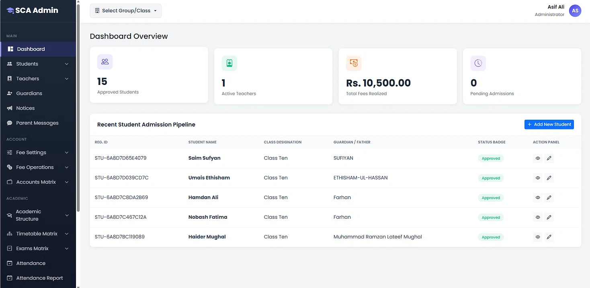
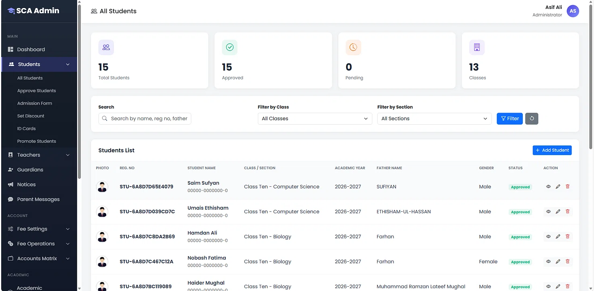
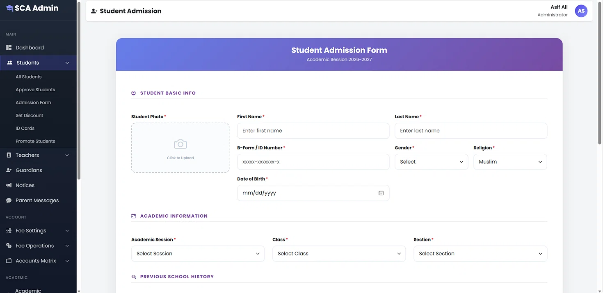

# SCA Admin - School Management System (PHP)

[](https://www.php.net/)
[](https://www.mysql.com/)
[](https://developer.mozilla.org/en-US/docs/Web/JavaScript)
[](https://opensource.org/licenses/MIT)

A comprehensive, modern web-based application designed to manage school operations efficiently. Built with PHP, this system features a sleek admin dashboard to handle student admissions, attendance, results, and fee management for administrators, teachers, and students.

## 📸 Application Previews

### Secure Login Portal

*Role-based login for Students, Teachers, Admins, and Guardians.*

### Dashboard Overview

*Real-time metrics for student admissions, active teachers, and fee collections.*

| Student Directory | Admission Form |
| :---: | :---: |
|  |  |
| *Advanced filtering and student management* | *Clean, multi-step data entry form* |

## 🚀 Features

**👥 User & Student Management**
- Manage Students, Teachers, and Guardians
- Comprehensive Student Admission Forms
- Advanced Search and Filtering (by Class, Section, or Name)
- Send Notices and Parent Messages

**💰 Financial Management**
- Configure Fee Settings and Discounts
- Track Fee Operations (Payments/Collections)
- View Accounts Matrix and Total Fees Realized

**📚 Academic Management**
- Define Academic Structure and Sessions
- Create Timetable Matrix
- Manage Exams Matrix and Attendance Reports
- Academic Calendar, Syllabus, and Daily Diary tracking

**⚙️ System**
- Real-time Dashboard Overview
- Secure Role-based Login/Logout (Admin, Teacher, Student)
- Fully customizable Settings

## 🛠️ Tech Stack
- **Backend:** PHP
- **Database:** MySQL
- **Frontend:** HTML, CSS, JavaScript
- **Dependency Manager:** Composer

## 📂 Project Structure

```text
SMS/
├── assets/          # CSS, JS, Images, and Frontend libraries
├── backend/         # Core PHP logic, Controllers, and Models
├── frontend/        # Views, UI templates, and Layouts
├── uploads/         # Directory for student photos/documents
├── vendor/          # Composer dependencies (Ignored in Git)
├── .htaccess        # Apache configuration
├── composer.json    # PHP package dependencies
├── database_migrations.sql # Database schema
└── index.php        # Application entry point
